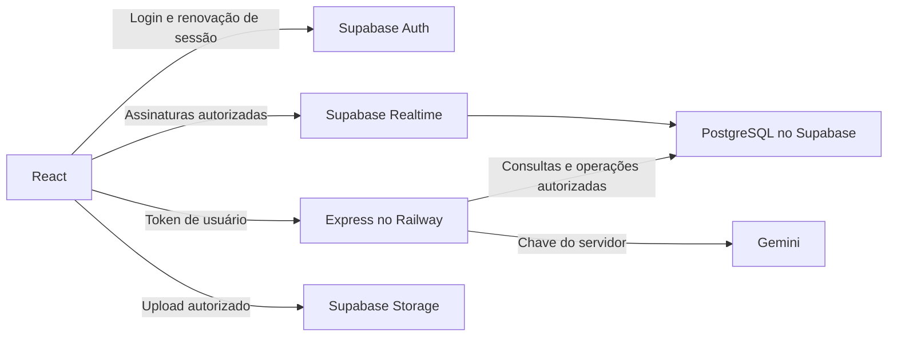

# Persistência do Koinonya

Análise de 12 de novembro de 2026. Base local `0a037cc`. O responsável informou que o Firebase contém apenas dados de teste. Este documento registra a recomendação de arquitetura e a sequência de migração proposta.

**Recomendação**

Adotar PostgreSQL como modelo de persistência e usar inicialmente Supabase gerenciado para banco, Auth, Storage e Realtime. Hospedar React e Express no Railway, com Gemini acessado pelo backend. Desenvolver localmente com a stack Supabase via CLI e Docker.

Essa recomendação considera uma equipe pequena, um produto com muitos relacionamentos e a necessidade de corrigir autorização, cadastro e integridade dos dados. A alternativa de Postgres diretamente no Railway passa a ser preferível se concentrar a infraestrutura nesse provedor e assumir a integração de autenticação, arquivos e atualizações em tempo real forem prioridades maiores.

O plano anterior adotava Firebase como premissa. A análise atual reabre essa escolha antes da implementação. Os critérios de segurança e validação funcional daquele plano continuam aplicáveis a qualquer banco.

**O que o código mostra**

- `services/db.ts` referencia 22 coleções de negócio e contém 25 chamadas `onSnapshot(...)`. Boa parte da troca de persistência pode ser concentrada nesse serviço, com adaptação dos seus contratos e consumidores.
- Sete arquivos TypeScript/TSX têm referências a Firebase. Além do serviço de dados, há dependências em login, sessão, senha, obtenção de token, dashboard e cadastro da igreja.
- `types.ts` declara 27 interfaces, incluindo entidades principais e estruturas embutidas. `firebase-blueprint.json` declara 17 entidades e cobre uma parte do modelo. O inventário precisa conciliar essas fontes com as escritas efetivas.
- `schema.sql` tem 3 bytes e carece de DDL utilizável. O modelo SQL precisa ser elaborado.
- O domínio inclui organizações, igrejas, usuários, membros, famílias, células, trilhas, escalas, campanhas, lançamentos, eventos e inscrições. Há referências cruzadas e dados derivados mantidos pelo cliente.
- A ausência de dados reais reduz o trabalho de conversão e corte de produção. O esforço principal será adaptar acesso a dados, autenticação, consultas e atualização das telas.

As contagens descrevem o código local. O estado publicado do banco, suas regras e índices ainda precisam ser capturados com autenticação. [Inventário e captura local](database/INVENTARIO_FIREBASE.md)

**Comparação das opções**

| Critério | PostgreSQL local em Docker e no Railway | Supabase gerenciado e aplicação no Railway | Firebase e aplicação no Railway |
| --- | --- | --- | --- |
| Modelo | Relacional, SQL, constraints e transações | PostgreSQL com os mesmos recursos relacionais | Documentos e coleções, com validação nas regras e na aplicação |
| Adequação ao domínio atual | Alta para relações, financeiro e relatórios | Alta para relações, financeiro e relatórios | Viável, exigindo disciplina nas referências e dados duplicados |
| Trabalho de migração | Alto, com API de dados e serviços complementares | Médio/alto, com troca de SDK, Auth, listeners e regras | Menor, concentrado em corrigir a implementação existente |
| Autenticação | Escolher e integrar provedor ou biblioteca de autenticação | Auth integrado, com adaptação dos fluxos atuais | Auth já utilizado pelo código |
| Arquivos | Escolher armazenamento de objetos e implementar autorização | Storage integrado | Storage disponível para integrar |
| Atualizações das telas | Implementar consulta/refetch e SSE/WebSocket quando necessário | Realtime disponível, com adaptação de semântica e acesso | Listeners já utilizados em grande parte do serviço de dados |
| Isolamento | API, vínculos, constraints e RLS conforme o desenho | API, vínculos, constraints e RLS | API, vínculos e regras Firestore |
| Operação | Controlar versões, conexões, backups e monitoramento com os recursos da plataforma | Plataforma reúne banco e serviços complementares | Serviços gerenciados, com revisão de consumo e regras |
| Portabilidade | Alta para dados e SQL | Alta para tabelas de negócio, com dependência adicional de Auth/Storage/Realtime | Migração para SQL exige converter o modelo e a camada de acesso |
| Localhost | Postgres em Docker e serviços auxiliares escolhidos | Stack local da CLI em containers | Emulator Suite |
| Principal motivo para escolher | Controle da aplicação e concentração no Railway | Equilíbrio entre SQL e serviços prontos para a equipe | Entregar a correção do código atual com menor alteração de stack |

PostgreSQL permite chaves estrangeiras, restrições de unicidade e políticas por linha. Supabase disponibiliza esses recursos e acrescenta serviços usados pelo aplicativo. O ambiente local do Supabase utiliza um runtime de containers compatível com Docker. [Constraints PostgreSQL](https://www.postgresql.org/docs/current/ddl-constraints.html) · [RLS PostgreSQL](https://www.postgresql.org/docs/current/ddl-rowsecurity.html) · [Supabase local](https://supabase.com/docs/guides/local-development)

O Railway oferece recursos de backup, recuperação para um instante no tempo, pooling e alta disponibilidade, cuja ativação e configuração fazem parte da implantação. Planejar atualizações, monitoramento, capacidade e ensaios de restauração continua sendo responsabilidade da equipe. [Operação de bancos no Railway](https://docs.railway.com/databases) · [Recuperação no Railway](https://docs.railway.com/volumes/point-in-time-recovery)

**Onde o PostgreSQL ajuda neste produto**

Uma inscrição pode referenciar um evento existente, um lançamento pode referenciar a campanha correspondente e uma escala pode referenciar participantes válidos. Constraints compostas permitem conferir que a referência pertence à mesma organização. Transações permitem tratar a última vaga de um evento e outras atualizações dependentes de forma consistente.

Relatórios financeiros e operacionais podem agregar dados no servidor, com filtros por igreja e período, evitando que o navegador precise carregar todas as coleções para calcular cada indicador. Esse é um benefício previsto pelo desenho relacional, a ser medido com as consultas reais.

O banco também permite registrar em migrations o esquema, índices, constraints, funções e políticas. Isso facilita reproduzir o mesmo modelo no computador, na homologação e na produção.

As brechas de autenticação, atribuição de papéis e exposição de dados identificadas no projeto exigem correções explícitas em qualquer opção. A adoção de SQL acrescenta mecanismos para expressar integridade e autorização.

**Por que a recomendação inicial é Supabase gerenciado**

O projeto já depende de login, arquivos e atualizações ao vivo. Supabase oferece esses serviços junto ao Postgres, reduzindo o conjunto de integrações que precisaríamos operar. O backend Express pode continuar concentrando operações públicas, transações de negócio, faturamento e Gemini. A interface pode ser adaptada módulo a módulo pela camada de serviços.

Supabase também pode ser auto-hospedado. Essa variante envolve uma stack com banco, Auth, gateway, Realtime, Storage e outros componentes. Para o primeiro piloto, a opção gerenciada reduz o trabalho operacional. Uma implantação própria deverá ter orçamento e procedimentos próprios de atualização, backup e segurança. [Arquitetura Docker do Supabase](https://supabase.com/docs/guides/self-hosting/docker) · [Responsabilidades de auto-hospedagem](https://supabase.com/docs/guides/self-hosting)

As tabelas de negócio poderão ser transferidas para outro PostgreSQL no futuro. Auth, políticas que usam suas funções, Storage e Realtime precisarão de adaptação nessa mudança. As migrations devem manter explícitas essas dependências.

**Arquitetura sugerida para a migração**

Para acesso normal via Data API, o backend encaminha o token verificado do usuário, preservando o contexto de RLS. Operações atômicas podem usar funções SQL controladas chamadas pela API. Credenciais administrativas ficam limitadas a provisionamento e manutenção, com validação explícita de escopo. Caso usemos conexões SQL diretas, será necessário configurar uma role de execução restrita e o contexto de autorização por transação.

Uma credencial administrativa pode contornar RLS. A credencial, as funções com privilégios elevados e seus grants precisam entrar nos testes de segurança. [RLS e credenciais Supabase](https://supabase.com/docs/guides/database/postgres/row-level-security)

Cada `onSnapshot` exige uma decisão de substituição. A estratégia inicial é consulta paginada, refetch após mutações e reconexão, e Realtime nos fluxos em que dois operadores precisam acompanhar alterações. Confirmar atualizações, exclusões, ordenação, expiração da sessão e recuperação de eventos perdidos. A escalabilidade deve ser medida com o número de assinantes e a política de autorização. [Postgres Changes](https://supabase.com/docs/guides/realtime/postgres-changes)

**Modelo multi-tenant proposto**

| Conceito | Representação proposta |
| --- | --- |
| Cliente contratante | `organizations` |
| Congregação/unidade | `churches`, com `org_id` |
| Identidade de login | Auth do provedor e `profiles` vinculado ao usuário |
| Vínculo com a organização | `organization_memberships`, com papel e situação de acesso |
| Acesso a igrejas específicas | `church_memberships`, para explicitar o alcance do usuário |
| Pessoa acompanhada pelo CRM | `members`, com organização e igreja |
| Níveis personalizados | Papéis e permissões de negócio com delegação restrita |
| Auditoria | Eventos com autor, organização, ação e horário do servidor |

Usar `org_id` nas tabelas de negócio e `church_id` quando a entidade pertence a uma igreja. Índices, constraints e chaves estrangeiras devem incluir o escopo apropriado. Por exemplo, uma referência `(org_id, church_id)` deve apontar para um par existente em `churches`, e uma referência a um membro deve respeitar o escopo definido para aquela operação.

RLS deve verificar vínculo ativo e permissões tanto em leitura quanto em criação, atualização e exclusão. O `org_id` recebido do navegador passa por validação contra a identidade autenticada. A equipe valida separadamente acesso entre organizações, acesso entre igrejas da mesma organização e conteúdo pastoral confidencial.

Usar UUIDs para os novos registros e um `legacy_id` opcional nos exemplos convertidos. Definir valores financeiros com representação decimal exata ou centavos inteiros. Escolher `date`, `time` e `timestamptz` conforme o significado de cada campo e documentar o fuso usado nas conversões. Normalizar listas que representam relacionamentos e manter JSONB para configuração variável com contrato explícito.

**Custos e esforço**

Preços abaixo foram consultados em 12 de novembro de 2026. Os valores são em dólares, antes de impostos, câmbio e consumo adicional.

| Opção | Formação do custo |
| --- | --- |
| Postgres no Railway | Recursos da API e do banco, volume, tráfego, backups e serviços complementares. O plano Hobby tem mínimo de US$ 5/mês com US$ 5 de uso incluído. Colaboração no workspace pode exigir Pro, com US$ 20/mês de uso incluído |
| Supabase gerenciado | Pro a partir de US$ 25/mês, com o primeiro projeto incluído. Projeto adicional a partir de US$ 10/mês. Somar Railway da aplicação, serviços adicionais e consumo acima das franquias |
| Firebase | Uso de Firestore, Auth, Storage e demais serviços, somado ao Railway. No Firestore, consultas, alterações e reconexões de listeners podem gerar leituras cobradas |

Para dois projetos pequenos pagos no Supabase, homologação e produção, a referência inicial é US$ 35/mês mais Railway e excedentes. O ambiente local usa containers. O plano gratuito permite avaliar a integração, mas seus projetos podem pausar após inatividade. O orçamento final depende de membros, operadores simultâneos, consultas, arquivos e chamadas de IA. [Preços Supabase](https://supabase.com/pricing) · [Preços Railway](https://docs.railway.com/pricing/plans) · [Cobrança Firestore](https://firebase.google.com/docs/firestore/pricing)

A comparação de esforço é qualitativa. A etapa mais importante para estimar a migração é implementar um fluxo completo com autenticação, organização, igreja e contatos. Reutilizar telas reduz retrabalho visual. Cadastro, permissões, índices, relatórios e atualização ao vivo precisam ser validados novamente.

**Captura e documentação da estrutura atual**

Foi gerado um arquivo ZIP com sete fontes do projeto, um inventário inferido e um manifesto com hashes SHA-256. As cópias preservam tipos, regras locais, blueprint, especificação de segurança, persistência, inicialização Firebase e exportador do aplicativo. O manifesto marca a origem como `local_source_structure` e a captura remota como pendente. [Arquivo local](database/firebase-local-structure-2026-11-12.zip) · [Manifesto](database/firebase-local-structure-2026-11-12.manifest.json)

O Firestore usa documentos com campos que podem variar. Para registrar o que realmente existe na nuvem, a captura deve obter coleções e subcoleções, tipos observados, variações de campos, índices, regras publicadas e configuração do banco. Auth e objetos de Storage precisam de inventário próprio. A correspondência entre esse estado remoto e o código será verificada antes de chamar o pacote de backup completo. [Modelo de dados Firestore](https://firebase.google.com/docs/firestore/data-model)

A exportação gerenciada do Firestore exige faturamento habilitado e um bucket Cloud Storage. Ela cobra leituras e exporta documentos, com índices definidos separadamente. A restauração precisa ser ensaiada. Para esta base de testes, uma captura autenticada em JSON tipado também pode servir à documentação e à transformação, desde que preserve caminhos, referências, timestamps e demais tipos. [Exportação e importação Firestore](https://firebase.google.com/docs/firestore/manage-data/export-import)

**Sequência proposta de migração**

| Entrega | Resultado verificável |
| --- | --- |
| 1. Inventário e captura | Fontes locais arquivadas, estado remoto capturado quando houver acesso e divergências documentadas |
| 2. Modelo SQL | Migrations de organizações, igrejas, perfis, vínculos e contatos, com constraints e RLS testáveis |
| 3. Fluxo completo local | Login, organização, igreja e CRUD de contatos funcionando entre duas organizações e três igrejas |
| 4. Dados de demonstração | Seeds reproduzíveis e exemplos selecionados convertidos com rastreabilidade dos IDs |
| 5. Adaptação por módulo | Serviço de dados e consumidores adaptados em grupos, com testes de comportamento e autorização |
| 6. Operações críticas | Vagas, retirada Kids, convites, cobranças e cotas de IA protegidos contra repetição e concorrência |
| 7. Integração real | Supabase de homologação, Gemini e aplicação local funcionando com regras e configurações versionadas |
| 8. Publicação | Railway de homologação, teste de restauração, produção e validação do piloto |

Na primeira entrega funcional, manter uma base de teste com organização A contendo duas igrejas e organização B contendo uma igreja. Verificar leitura, escrita, relatórios, alterações concorrentes e acesso negado. A próxima migração de módulo depende desse padrão estar correto.

Recriar usuários de teste no provedor escolhido e converter apenas os exemplos necessários. O backup permite consultar o desenho anterior. No banco novo, o objetivo é registrar relações e restrições consistentes, com fixtures que exercitem os cenários de produto.

**Se a escolha for PostgreSQL diretamente no Railway**

Aplicar o mesmo modelo SQL e o mesmo fluxo piloto. Acrescentar uma escolha explícita para autenticação de usuários, armazenamento de arquivos e atualização das telas. Login pode usar um provedor gerenciado independente ou uma biblioteca consolidada, incluindo senha, recuperação, verificação de e-mail, Google, revogação e sessões.

Rodar o PostgreSQL local em Docker Compose com versão compatível com a produção. Usar migrations para reproduzir o esquema no Railway, pool de conexões e rede privada entre API e banco. A publicação inclui configurar backup, retenção, restauração, monitoramento e atualização de versão. Os dados e o esquema podem aproveitar ferramentas PostgreSQL como `pg_dump` e `pg_restore`.

Essa alternativa concentra mais decisões no backend e dá maior controle sobre as integrações. Sua viabilidade será comparada ao Supabase pelo fluxo piloto e pelo custo total de operação, incluindo o tempo da equipe.

**Estado desta decisão**

A recomendação técnica é PostgreSQL com Supabase gerenciado e Express no Railway. A análise e a captura local estão preparadas. A seleção final do provedor, a captura autenticada do Firebase e a execução das migrations permanecem como próximas decisões e entregas.
