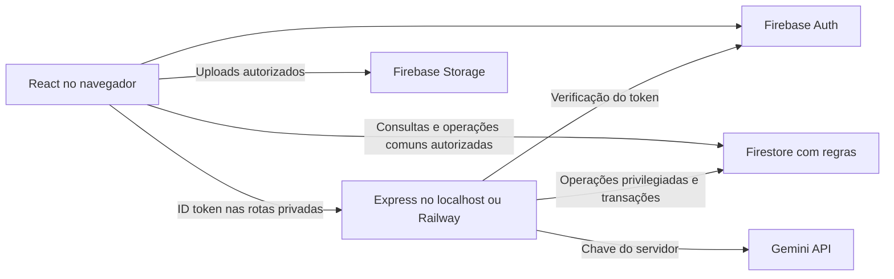

# Plano de desenvolvimento do Koinonya

Preparado em 12 de novembro de 2026, com base no commit local `0a037cc`, na conversa recuperada do Claude e na revisão do código. Este documento descreve trabalho planejado. A validação por execução começa na primeira etapa.

Revisão de arquitetura em 12 de novembro de 2026. A escolha da persistência foi reaberta para comparar PostgreSQL no Railway, Supabase e Firebase. A recomendação e a sequência de migração estão em [Análise de persistência](ANALISE_PERSISTENCIA.md). As etapas específicas de Firebase abaixo representam a proposta anterior e dependem da decisão final do provedor. Os critérios funcionais e de segurança servem de base para o plano revisado.

O objetivo é entregar o aplicativo funcionando no localhost, conectado a Firebase e Gemini reais, e depois publicar a mesma aplicação no Railway. A conclusão depende do funcionamento dos módulos, da proteção dos dados e de testes das operações críticas.

**Decisões e premissas**

- O Firebase atual contém apenas dados de teste, conforme informado pelo responsável pelo projeto. A implantação proposta começa com uma base limpa e cenários de teste reproduzíveis.
- Adotar dois projetos Firebase próprios, com IDs a confirmar conforme disponibilidade. `koinonya-dev` atende à integração e homologação. `koinonya-prod` atende à produção. O desenvolvimento cotidiano usa emuladores locais.
- Cada projeto Firebase contém várias organizações. Cada organização pode conter várias igrejas. A autorização precisa controlar tanto `org_id` quanto o escopo de igreja.
- Usar o banco Firestore `(default)` nos novos projetos. Centralizar a configuração do projeto e do banco para que navegador, servidor, CLI e testes apontem para o mesmo destino.
- Adotar um serviço Express no Railway, servindo o frontend compilado e a API no mesmo domínio. Criar ambientes Railway de homologação e produção, cada um ligado ao Firebase correspondente.
- Usar npm como gerenciador de referência, aproveitando `package-lock.json`. Confirmar a instalação reproduzível antes de consolidar os arquivos de dependências.
- Seu pai conduz os cenários de uso e a validação funcional. Você conduz arquitetura, segurança, integrações e implantação. Os dois validam as permissões propostas abaixo.

Os projetos Firebase são independentes do editor usado para desenvolver o aplicativo. Para reutilizar o projeto criado no AI Studio, seria necessário conferir acesso IAM, propriedade e faturamento, configuração do aplicativo web, banco nomeado, provedores de autenticação, regras publicadas e credenciais administrativas. A proposta de projetos novos aproveita a existência exclusiva de dados de teste e permite configurar os ambientes explicitamente. O isolamento entre clientes será implementado na aplicação e nas regras. [Ambientes Firebase](https://firebase.google.com/docs/projects/dev-workflows/general-best-practices) · [Acesso IAM](https://firebase.google.com/docs/projects/iam/overview)

**Arquitetura proposta**

Os campos de autorização do usuário terão escrita controlada pelo servidor. A proposta inicial reaproveita o perfil associado ao UID como fonte de papel, organização, igreja e situação de acesso, com regras restritivas para as edições pessoais. A API consulta essa autorização após verificar o token. Isso permite controlar bloqueios e mudanças de papel de forma explícita. Se forem adotadas custom claims, a implementação deverá incluir renovação, revogação e consistência com o cadastro persistido. [Verificação de tokens](https://firebase.google.com/docs/auth/admin/verify-id-tokens) · [Custom claims](https://firebase.google.com/docs/auth/admin/custom-claims)

O Admin SDK tem acesso privilegiado ao banco. Por isso, cada rota que o utiliza precisa validar identidade, escopo e permissão antes da operação. As regras do Firestore protegem os acessos feitos pelo SDK cliente. [Testes e limites de aplicação das regras](https://firebase.google.com/docs/firestore/security/test-rules-emulator)

**Sequência de entregas**

| Etapa | Entrega | Dependências | Evidência de conclusão |
| --- | --- | --- | --- |
| 0 | Instalação e build reproduzíveis | Código atual | Instalação limpa, TypeScript, build e inicialização de produção verificados |
| 1 | Ambiente local e configuração Firebase | Etapa 0 | App conectado aos emuladores, dados de teste reproduzíveis e ambiente identificado |
| 2 | Cadastro, equipe e permissões | Etapa 1 | Fluxos de autenticação completos e testes de isolamento aprovados |
| 3 | Integridade dos dados e operações críticas | Etapa 2 | Concorrência, repetição de requisições, portal e check-in validados |
| 4 | Correções funcionais de todos os módulos | Etapas 2 e 3 | Matriz de módulos abaixo validada no localhost |
| 5 | Gemini integrado e controlado | Etapa 2 | Geração real, streaming, falhas e limites verificados |
| 6 | Homologação com Firebase real | Etapas 3, 4 e 5 | Fluxos completos, índices e regras verificados no projeto dev |
| 7 | Railway e entrada em produção | Etapa 6 | Homologação publicada, restauração e reversão exercitadas, piloto validado |

As etapas 4 e 5 podem ser desenvolvidas em branches independentes depois de estabilizar os contratos de autenticação e API. A primeira execução da etapa 0 fornecerá a base para estimar o esforço das correções. Cada entrega deve registrar o que foi testado e os defeitos ainda abertos.

**Etapa 0 — Instalação e execução**

- Registrar a versão de Node compatível com as dependências, instalar com `pnpm install --frozen-lockfile` e verificar conflitos no lockfile. Revisar dependências vulneráveis e imports de pacotes usados diretamente, incluindo `ws`.
- Executar `pnpm lint`, que atualmente faz a checagem TypeScript, e `pnpm build`. Corrigir os erros observados mantendo os contratos dos componentes e serviços.
- Integrar Tailwind ao build, criar o CSS de entrada e consolidar o carregamento de React e demais bibliotecas pelo Vite. Conferir estilos dinâmicos, cores de etapas, ícones e modo escuro.
- Corrigir o curinga da rota de frontend para Express 5 e garantir respostas JSON nas rotas de API desconhecidas.
- Preparar build do frontend em `dist/` e do backend em `dist-server/`, com o caminho de arquivos estáticos resolvido corretamente após compilar o servidor.
- Criar comandos explícitos de desenvolvimento e produção, carregamento de variáveis no servidor, validação da configuração e `/api/health`.
- Criar um README com instalação, configuração, execução e resolução dos erros encontrados. Atualizar `.gitignore` para arquivos de ambiente com segredos, credenciais e saídas de build.

O aceite inclui iniciar o servidor compilado em modo de produção local, abrir a página inicial e uma URL interna diretamente, conferir assets e testar uma rota de API. O projeto atual usa `app.get('*', ...)`, e o Express 5 exige um curinga nomeado. [Migração do Express 5](https://expressjs.com/en/guide/migrating-5/#path-syntax)

**Etapa 1 — Configuração e dados locais**

- Criar `.env.example`, configuração validada no frontend e no backend, `firebase.json`, aliases dos projetos, regras e índices versionados.
- Configurar Emulator Suite para Auth, Firestore e Storage. Usar um projeto local com prefixo `demo-`, regras carregadas explicitamente e banco `(default)`.
- Criar scripts de dados fictícios para duas organizações. A organização A terá duas igrejas, e a organização B terá uma igreja. Incluir usuários de todos os papéis e registros dos módulos críticos.
- Transformar a geração automática de demonstrações em uma ação explícita do ambiente de desenvolvimento. O script deverá ser repetível e reconhecer seu ambiente de destino.
- Preparar os projetos Firebase dev e prod, aplicativo web, responsáveis IAM, credenciais de servidor por ambiente e configuração de faturamento conforme os serviços habilitados.
- Configurar Auth por e-mail/senha e Google, domínios autorizados, recuperação de senha e verificação de e-mail. Validar também os links de ação do Auth.
- Preparar Storage para logos e avatares, com limites de tamanho, tipos aceitos, regras e limpeza dos arquivos substituídos.

O aceite inclui criar uma conta local, persistir dados, recarregar a aplicação e recuperar os mesmos registros. O destino Firebase deve estar identificável nos logs de inicialização sem revelar credenciais. Os emuladores suportam o desenvolvimento local com um projeto demonstrativo. [Auth no Emulator Suite](https://firebase.google.com/docs/emulator-suite/connect_auth)

**Contrato de configuração a implementar**

| Uso | Configuração proposta | Disponibilidade |
| --- | --- | --- |
| Firebase no navegador | `VITE_FIREBASE_API_KEY`, `VITE_FIREBASE_AUTH_DOMAIN`, `VITE_FIREBASE_PROJECT_ID`, `VITE_FIREBASE_APP_ID`, `VITE_FIREBASE_STORAGE_BUCKET`, `VITE_FIREBASE_MESSAGING_SENDER_ID`, `VITE_FIREBASE_DATABASE_ID` | Build do frontend |
| Emuladores no navegador | `VITE_USE_FIREBASE_EMULATORS` e endereços locais definidos na configuração | Desenvolvimento |
| Firebase no servidor | `FIREBASE_PROJECT_ID`, `FIREBASE_DATABASE_ID`, `FIREBASE_STORAGE_BUCKET` e credencial administrativa do ambiente | Execução do backend |
| Credencial administrativa | ADC/arquivo local protegido ou `FIREBASE_SERVICE_ACCOUNT_JSON` lido pelo backend | Segredo do servidor |
| Emuladores no servidor | `FIREBASE_AUTH_EMULATOR_HOST`, `FIRESTORE_EMULATOR_HOST`, `FIREBASE_STORAGE_EMULATOR_HOST` | Desenvolvimento |
| Gemini | `GEMINI_API_KEY`, `GEMINI_MODEL` e limites por organização | Execução do backend |
| Serviço web | `NODE_ENV`, `PORT`, `APP_ORIGIN` e configuração explícita do proxy | Execução do backend |

As variáveis `VITE_*` entram no código entregue ao navegador e são resolvidas durante o build. A chave do Gemini e a credencial administrativa ficam no servidor. A configuração web do Firebase identifica o projeto, e seu acesso depende das regras, Auth e demais controles. A troca de Firebase no frontend requer um novo build. [Variáveis do Vite](https://vite.dev/guide/env-and-mode) · [Configuração dos projetos Firebase](https://firebase.google.com/docs/projects/learn-more)

**Etapa 2 — Autenticação, cadastro e autorização**

- Implementar `firebase-admin` e verificar o ID token nas rotas privadas, incluindo expiração, projeto emissor e revogação conforme a política de sessão. Consultar o vínculo e a situação atual do usuário e da organização.
- Centralizar no backend o provisionamento da organização, igreja e perfil. O cliente autenticado chama uma operação de finalização do cadastro. O servidor define o papel inicial, limites, plano e demais campos privilegiados.
- Tornar o provisionamento repetível por UID, com criação atômica dos documentos Firestore e recuperação de tentativas interrompidas. A criação da conta Auth e as escritas Firestore exigem tratamento próprio para falhas entre os serviços. [Transações Firestore](https://firebase.google.com/docs/firestore/manage-data/transactions)
- Substituir o cadastro de equipe com ID aleatório por convites com organização, igreja, papel, validade e consumo único. Ao aceitar, associar o UID autenticado a um e-mail verificado correspondente ao convite. Validar também quem já possui conta.
- Implementar alteração de papéis, remoção de vínculo, bloqueio de acesso e proteção do último administrador da organização. Separar a presença `online/busy/offline` da situação de acesso da conta.
- Criar um procedimento administrativo explícito para o primeiro `SUPER_ADMIN`, vinculado a um UID real. Registrar alterações privilegiadas em auditoria.
- Proteger `role`, `org_id`, `church_id`, permissões e campos de cobrança contra alteração direta pelo cliente. Permitir edição dos campos pessoais previstos no contrato.
- Revisar as regras de todas as coleções, validar campos e tipos em criação e atualização, conferir IDs e vínculos e aplicar a política de organização ativa.
- Implementar o aceite e a versão dos termos usados pelo produto, com horário registrado pelo servidor e rotas necessárias para concluir o próprio aceite.
- Adaptar consultas, listeners e carregamento das telas às permissões. Encerrar assinaturas e limpar dados em memória no logout ou na troca de organização/igreja.

As consultas do Firestore precisam respeitar os limites expressos nas regras. Para usuários com acesso restrito, carregar apenas as igrejas e categorias de dados autorizadas. [Consultas e regras](https://firebase.google.com/docs/firestore/security/rules-query)

**Matriz inicial de autorização proposta para validação funcional**

| Papel existente | Escopo proposto | Operações principais |
| --- | --- | --- |
| `SUPER_ADMIN` | Plataforma | Provisionamento, planos, suporte e acesso global auditado, conforme a especificação atual |
| `ADMIN` | Organização e suas igrejas | Equipe, configurações, gestão e financeiro da organização |
| `PASTOR` | Igreja vinculada | Gestão pastoral, financeiro permitido e pedidos confidenciais da própria igreja |
| `LEADER` | Igreja e grupos atribuídos | Contatos e atividades sob responsabilidade, células, discipulado e escalas autorizadas |
| `RECEPTION` | Igreja vinculada | Cadastro operacional, eventos e check-in autorizados |
| `VOLUNTEER` | Igreja e atribuições | Consulta e execução das atividades explicitamente permitidas |

Os pedidos `PASTOR_CONFIDENTIAL` terão leitura pastoral restrita, além do acesso global previsto para `SUPER_ADMIN`. A implementação deve validar com vocês a necessidade de acesso de outros responsáveis. Níveis personalizados e `permissions` serão vinculados a ações reais da API e das regras, com limites de delegação. Uma permissão criada pela organização precisa permanecer dentro do escopo dessa organização.

Para a primeira versão, propor acesso de organização para `ADMIN` e vínculo a uma igreja para os demais papéis locais. A necessidade de um usuário atuar em várias igrejas específicas deve ser resolvida na validação desta matriz, antes de fechar o modelo de vínculos.

O aceite exige testar acesso permitido e negado, inclusive entre duas igrejas da mesma organização. Cobrir criação e atualização indevida de papéis, troca de organização, campos adicionais, conta bloqueada, token inválido, convite reutilizado, cadastro interrompido e repetição concorrente da finalização.

**Etapa 3 — Integridade e operações críticas**

- Centralizar esquemas e validações usados pelo servidor e pelos formulários. Especificar campos obrigatórios, opcionais, imutáveis e removíveis, além dos limites de strings e listas.
- Conferir referências entre organização, igreja, pessoa, evento, célula e usuário. Eliminar o uso de uma igreja fictícia `main` para completar vínculos ausentes.
- Definir contratos para criação e edição que evitem sobrescrever campos de outro editor. Operações dependentes entre si usarão transação ou batch conforme a necessidade.
- Padronizar datas persistidas, apresentação em `America/Sao_Paulo` e tratamento de datas inválidas. Usar horário do servidor em registros de auditoria e operações privilegiadas.
- Revisar arquivamento, restauração e exclusão definitiva, incluindo as referências que permanecem em outros módulos.
- Criar rotas públicas para check-in de visitantes, pedidos de oração e inscrições. Resolver organização, igreja e evento a partir do recurso público autorizado e aplicar validação, limite de requisições, limite de payload e verificação antiabuso validada no servidor.
- Criar uma projeção de igreja pública com lista explícita de campos. Fechar a leitura pública do documento administrativo após adaptar o portal.
- Processar inscrições com verificação de evento aberto, capacidade, preço, igreja e organização. Usar transações e chave de repetição da requisição para evitar exceder vagas e duplicar inscrições.
- Derivar valores e situação financeira da inscrição no servidor. Atualmente `amount_paid` recebe o preço mesmo quando o pagamento está `PENDING`, e o navegador fornece o valor da inscrição.
- Processar retirada Kids no servidor, com permissão específica, validação do código, limite de tentativas e transição única de estado. Separar o material de impressão do comprovante do segredo usado na validação. Revisar a mensagem de erro atual, que revela o código esperado.
- Usar identificadores adequados para registros e códigos imprevisíveis para convites, ingressos e retirada. Registrar autor e horário das ações críticas.

O aceite inclui duas inscrições simultâneas disputando a última vaga, repetição de check-in, retirada com código incorreto, tentativa de retirada por usuário sem permissão e duas confirmações concorrentes da mesma retirada. As tentativas devem produzir estados consistentes e respostas compreensíveis.

**Etapa 4 — Correção e validação dos módulos**

Cada linha abaixo deve ter os fluxos normais, falhas de gravação, permissões e persistência após recarregar a página verificados. Refatorar `App.tsx` e `services/db.ts` progressivamente ao corrigir cada fluxo, mantendo os contratos usados pelos componentes.

| Módulos | Trabalho e critérios de aceite |
| --- | --- |
| Login, perfil e equipe | Cadastro completo, login por e-mail e Google, recuperação de senha, atualização de perfil, convite, alteração de papel e bloqueio de acesso funcionam |
| Organização, igrejas e configurações | Vínculos corretos, alternância de igreja, limites do plano aplicados, permissões efetivas e preferências persistidas |
| Contatos e pipeline | Criar, editar, mover etapa, importar CSV, exportar, arquivar e restaurar sem perder campos. Importação informa falhas por registro e possui regra explícita de duplicidade |
| Agenda | Novo evento cria um registro próprio. Editar e excluir afetam o evento selecionado. Horários permanecem corretos após salvar e recarregar. Data final respeita a inicial |
| Células | Cadastro, liderança, vínculo de membros, reuniões, presença e exclusão respeitam igreja e referências |
| Discipulado | Trilhas, responsáveis, progresso, conclusão e retomada persistem e respeitam o acesso por pessoa/grupo |
| Ministérios e escalas | Cadastro, vínculos, atribuição, confirmação e alteração de escala respeitam responsáveis e evitam registros inconsistentes |
| Check-in e Kids | Presença única conforme a sessão, emissão de comprovante, retirada autorizada, histórico e tentativa concorrente validados |
| Cuidado pastoral | Privacidade aplicada na consulta e na escrita, visita vinculada corretamente e dados confidenciais limitados aos responsáveis permitidos |
| Eventos e inscrições | Portal, vagas, inscrição, cancelamento, ingresso, check-in e valores derivados do evento consistentes |
| Financeiro da igreja | Receitas, despesas, campanhas, totais, centavos, filtros e datas corretos. Escritas e exportações respeitam o papel e a igreja |
| Comunicação e automações | Geração, edição, abertura do WhatsApp, campanhas e histórico funcionam. O status distingue mensagem preparada, abertura do WhatsApp e envio confirmado por provedor |
| Dashboard | Indicadores respeitam igreja, período, arquivamento e permissões. Informações enviadas à IA correspondem aos dados autorizados |
| Gestão SaaS | Provisionamento e limites no servidor. Faturas por competência são idempotentes. Transições de assinatura e vencimento validadas. Código PIX demonstrativo identificado e substituído no fluxo de cobrança real |
| Exportação e restauração | Exportação identifica o escopo, a versão e as coleções cobertas. Criar restauração testada com vínculos e datas consistentes. O exportador atual cobre apenas parte dos módulos |
| Logos, avatares e uploads | Imagens persistidas no Storage, tipos e tamanhos validados, acesso por organização e substituição com limpeza. O logo atual aceita imagem de até 2 MB e a serializa no documento |
| PWA, navegação e erros | Instalação e atualização funcionam. Reconexão e sessão expirada têm tratamento. Cache de assets e logout são verificados para evitar exibição de dados de outra sessão |

A situação de assinatura terá um contrato único no backend, nas regras e na interface. `ACTIVE` e `TRIAL` seguem as permissões normais. A política de tolerância de `PAST_DUE` precisa de definição comercial. `SUSPENDED`, `CANCELED` e organização inativa bloqueiam operações de negócio conforme a política definida, mantendo os caminhos necessários para login, consulta de cobrança e regularização.

O financeiro da igreja e a cobrança da assinatura SaaS terão critérios próprios. O primeiro precisa funcionar neste ciclo. Para o piloto, a assinatura pode ser gerida por operação administrativa auditada. A cobrança automática terá uma entrega específica com gateway escolhido, webhook autenticado, processamento repetível, conciliação, cancelamento e agendamento no servidor. A liberação comercial com cobrança depende dessa entrega.

Os fluxos atuais de comunicação usam links `wa.me`. A eventual automação de envio por WhatsApp, Direct ou Messenger exige definição de provedor e integração própria. Até sua entrega, a interface e o histórico devem representar a ação efetivamente executada.

**Etapa 5 — Gemini real e controlado**

- Configurar `GEMINI_API_KEY` no backend e escolher `GEMINI_MODEL` por ambiente. Confirmar acesso ao modelo com a credencial do projeto e uma chamada pequena de teste.
- Adaptar os consumidores existentes de mensagens e diagnóstico pastoral aos contratos autenticados. Resolver e validar no servidor o contexto da organização e da igreja.
- Definir tarefas de IA e limites de entrada. Montar instruções de sistema e selecionar modelos no backend, com rotas e payloads específicos para as funcionalidades usadas.
- Aplicar autorização, limite por usuário, cota por organização, limite de concorrência, tamanho máximo da resposta e timeout. Persistir as cotas que precisam sobreviver a reinícios ou múltiplas instâncias.
- Indicar na resposta e na interface se houve geração pelo modelo, uso de mensagem padrão ou falha. Tratar chave ausente, modelo indisponível, 401, 403, 429 e erro do provedor.
- Corrigir streaming para propagar erros, reconhecer encerramento, cancelar a chamada ao desconectar o cliente e fechar recursos. Validar o fluxo SSE no navegador.
- Minimizar dados enviados ao provedor e aplicar as mesmas permissões dos módulos de origem, especialmente nos dados pastorais.
- Decidir com o produto se o assistente de voz entra no primeiro piloto. A proposta inicial mantém a funcionalidade sob ativação explícita no servidor. Sua ativação exige autenticação no handshake, origem permitida, limite de duração, consumo e encerramento de sessões.

O catálogo oficial consultado inclui `gemini-4-hydrogen` e `gemini-3.8-live`. A validação pendente é a disponibilidade para a conta usada e a compatibilidade das chamadas, parâmetros e SDK instalados. [Catálogo Gemini](https://ai.google.dev/gemini-api/docs/models) · [Chaves da API](https://ai.google.dev/gemini-api/docs/api-key)

O aceite exige uma mensagem e um diagnóstico realmente gerados, erro visível quando a integração falha, chamadas anônimas negadas, cota respeitada e streaming encerrado corretamente. Os testes automatizados comuns usarão respostas controladas, e um teste explícito validará a integração real.

**Etapa 6 — Homologação com serviços reais**

- Publicar regras, índices e configuração de Storage no projeto dev usando os arquivos versionados.
- Conectar o localhost ao Firebase dev e ao Gemini real. Conferir configuração cliente/servidor, domínios Auth, credenciais e acesso ao banco escolhido.
- Reexecutar os fluxos essenciais com os mesmos cenários de duas organizações e três igrejas usados localmente.
- Validar os índices necessários às consultas reais, paginação, listeners e volume de leituras. O emulador não exige os índices compostos da mesma forma que o serviço real. [Limitações do emulador Firestore](https://firebase.google.com/docs/emulator-suite/connect_firestore)
- Configurar e observar App Check nos recursos compatíveis. Aplicar enforcement após validar os clientes legítimos e as rotas públicas, mantendo autorização e limites de uso em cada camada.
- Testar exportação, restauração e recuperação de cadastro interrompido. Documentar também o provisionamento e a recuperação dos vínculos Auth, Firestore e Storage.
- Automatizar no CI a instalação, checagem TypeScript, build e testes críticos de regras/API. Incluir testes de interface dos fluxos que historicamente sofreram regressões.

O aceite deste marco é o aplicativo utilizável no localhost com Firebase e Gemini reais, módulos validados e defeitos críticos resolvidos. Registrar resultados e pendências funcionais antes de promover a versão para o Railway.

**Etapa 7 — Railway e produção**

- Configurar build determinístico, versão Node, comando de início do servidor compilado e variáveis específicas de homologação.
- Ouvir em `0.0.0.0` na porta fornecida por `PORT`. Configurar `/api/health` como verificação de prontidão. A resposta confirma que a aplicação está pronta para receber tráfego, com diagnóstico de dependências separado de chamadas pagas à IA. [Express no Railway](https://railway.com/guides/express) · [Healthchecks](https://docs.railway.com/deployments/healthchecks)
- Configurar domínio HTTPS, origem da aplicação, domínios autorizados do Firebase Auth e confiança no proxy conforme a topologia do Railway. Validar limites de requisição com o endereço real do cliente.
- Validar frontend, assets, links diretos, login Google, convites, formulários públicos, uploads, streaming e encerramento de sessões no ambiente publicado.
- Preparar logs estruturados com identificador de requisição, erros, uso e consumo de IA, protegendo credenciais e conteúdo pessoal. Configurar acompanhamento contínuo de disponibilidade, erros e orçamento.
- Validar reinício e atualização da aplicação, persistência das cotas e encerramento gracioso. Documentar como retornar ao deploy anterior.
- Configurar Firebase prod com regras, índices e Storage equivalentes, credenciais próprias e dados iniciais administrativos explícitos.
- Publicar uma versão piloto, validar com vocês os fluxos de uso e acompanhar os primeiros acessos. Repetir o teste de isolamento no ambiente final com contas de teste controladas.
- Antes de incorporar dados reais, validar os textos e processos de privacidade do produto, retenção, exportação e exclusão, além de restauração de backup.

As mudanças de aplicação, regras e dados terão sequência de publicação compatível. Publicar índices antecipadamente quando uma nova consulta depender deles. Registrar qualquer transformação de dados e sua recuperação, para que uma reversão da aplicação continue utilizável.

**Testes que definem a conclusão**

| Grupo | Cobertura mínima |
| --- | --- |
| Autorização | Ataques de `security_spec.md`, elevação de papel em create/update, acesso entre organizações e igrejas, permissões personalizadas e sigilo pastoral |
| Identidade | Conta nova, Google, perfil incompleto, convite existente/expirado/reutilizado, suspensão e mudança de papel |
| Persistência | CRUD dos módulos, arquivamento/restauração, CSV, datas, valores financeiros e falhas de gravação |
| Concorrência | Cadastro repetido, última vaga do evento, retirada Kids, geração de fatura e consumo de cota de IA |
| Integrações | Auth/Firestore/Storage reais, Gemini real, SSE, falhas de credencial, limites e reconexão |
| Implantação | Build limpo, execução compilada, healthcheck, domínio HTTPS, reinício, nova versão, reversão e restauração |

Os testes de regras incluirão os caminhos legítimos junto aos caminhos negados. A versão corrigida precisa permitir o trabalho de cada papel. Usar `@firebase/rules-unit-testing` nos emuladores, testes da API e testes de interface focados em cadastro, contatos, agenda, convite, portal e check-in.

**Primeira entrega executável**

1. Registrar o estado inicial e abrir a branch de correções de ambiente.
2. Instalar dependências e obter os resultados reais de TypeScript e build.
3. Corrigir inicialização, assets e estilos, e criar o contrato de configuração.
4. Entregar os emuladores e os cenários fictícios de duas organizações.
5. Apresentar o localhost funcionando e a lista de falhas reproduzidas, com prioridade para cadastro e autorização.

**Dependências de decisão ou acesso**

| Momento | Definição necessária | Responsável |
| --- | --- | --- |
| Configuração dos projetos | Contas responsáveis, IDs disponíveis, região, faturamento e acessos Firebase/GCP | Você e seu pai |
| Fechamento da etapa 2 | Permissões por papel, sigilo pastoral e usuários que atuam em várias igrejas | Você e seu pai |
| Integração real da IA | Chave do projeto, modelo acessível e teto de consumo por organização | Você |
| Convites em homologação | Remetente e serviço de e-mail, ou distribuição manual explícita do link no piloto | Vocês |
| Publicação no Railway | Conta/workspace, projeto, domínio e variáveis protegidas | Você |
| Cobrança comercial | Gateway, planos, tolerância de atraso e regras de cancelamento | Seu pai com validação técnica sua |
| Recursos adicionais | Prioridade de voz e de envio automático de mensagens | Seu pai |

O planejamento está concluído. As etapas de implementação, criação dos projetos, testes em execução e publicação serão acompanhadas pelos critérios acima.
